# Bricktrack – Anleitung

So benutzt du Bricktrack im Alltag. Die Bilder sind auf einem Handy
aufgenommen, weil die App genau dafür gebaut ist: für den Laden und das
Kinderzimmer, nicht für den Schreibtisch.

> Installation und Reverse Proxy stehen im [Schnellstart](../QUICKSTART.md).
> Die Bilder hier lassen sich mit `pnpm screenshots` jederzeit neu erzeugen –
> sie stammen aus den Beispieldaten des Seed-Skripts.

---

## Inhalt

1. [Das erste Konto](#1-das-erste-konto)
2. [Der Überblick](#2-der-überblick)
3. [Stammdaten anlegen](#3-stammdaten-anlegen)
4. [Sets in den Katalog](#4-sets-in-den-katalog)
5. [Was fehlt noch? Mehrere Sets auf einmal auswählen](#5-was-fehlt-noch)
6. [Die Set-Detailseite](#6-die-set-detailseite)
7. [Die Sammlung](#7-die-sammlung)
8. [Wunschlisten](#8-wunschlisten)
9. [Teilen – so sehen es Oma und Tante Anne](#9-teilen)
10. [Passkeys einrichten](#10-passkeys-einrichten)
11. [Antworten auf die zwei wichtigen Fragen](#11-die-zwei-fragen)

---

## 1. Das erste Konto

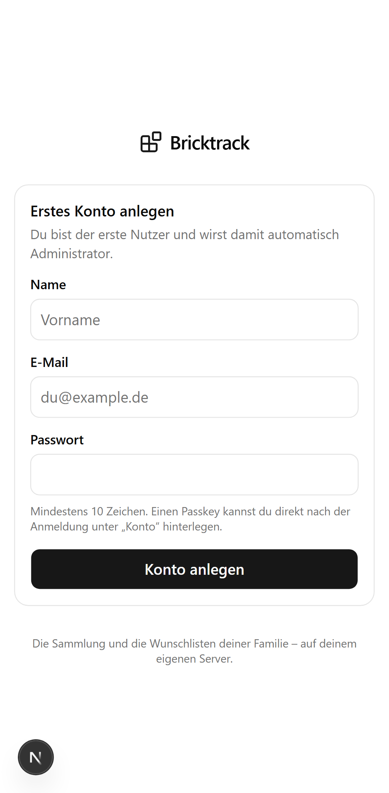

Beim allerersten Aufruf landest du direkt auf der Registrierung. **Wer sich
zuerst registriert, wird Administrator** – danach ist die Registrierung
geschlossen. Melde dich also gleich selbst an, bevor es jemand anderes tut.

Das Passwort braucht mindestens zehn Zeichen. Einen Passkey hinterlegst du
gleich danach unter „Konto" (siehe [Abschnitt 10](#10-passkeys-einrichten)).

---

## 2. Der Überblick

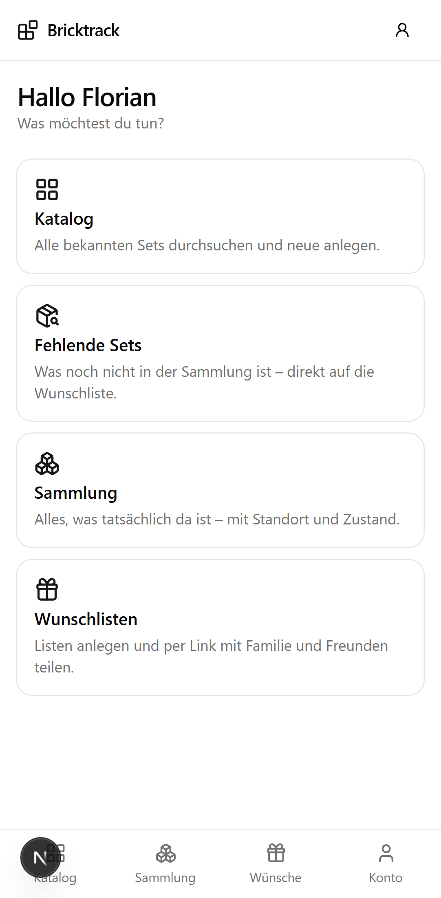

Die Startseite ist die Abzweigung zu den vier Bereichen:

| | |
|---|---|
| **Katalog** | Alle bekannten Sets – egal ob vorhanden oder nicht |
| **Fehlende Sets** | Der direkte Weg zu allem, was noch fehlt |
| **Sammlung** | Was tatsächlich da ist |
| **Wunschlisten** | Zum Teilen mit Familie und Freunden |

Unten am Bildschirmrand liegt die Navigation – auf dem Handy mit dem Daumen
erreichbar.

---

## 3. Stammdaten anlegen

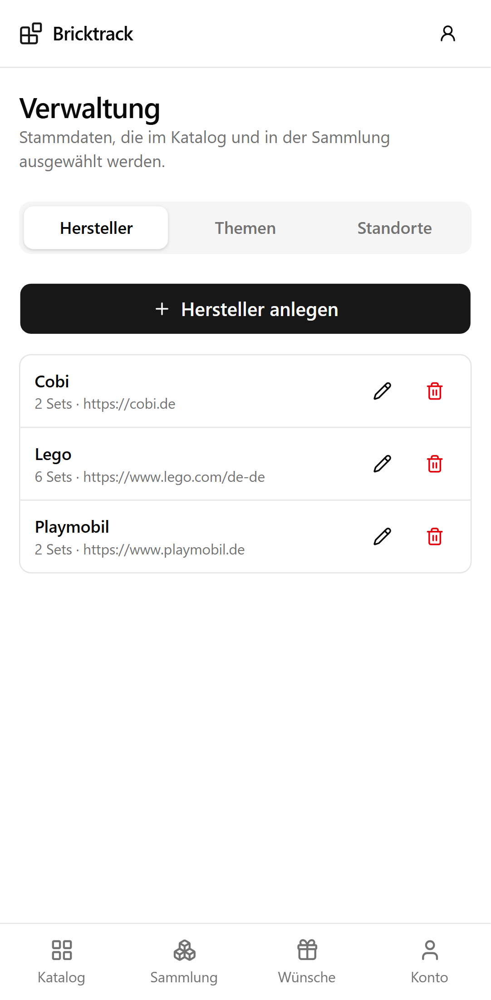

Bevor du Sets anlegst, brauchst du mindestens einen **Hersteller**. Zu finden
über das Konto-Menü oben rechts → **Verwaltung**.

Drei Arten von Stammdaten:

- **Hersteller** – Lego, Playmobil, Cobi, BlueBrixx … beliebig erweiterbar.
  Die hinterlegte Website erscheint später als „Zum Shop"-Link auf der
  geteilten Wunschliste.
- **Themen** – Serien wie „City", „Technic", „Novelmore". Themen gehören zu
  einem Hersteller und können Unterthemen haben („City → Feuerwehr").
- **Standorte** – „Regal Kinderzimmer", „Kiste Keller 3". Auch schachtelbar,
  damit „Keller → Kiste 3" möglich ist.

> Ein Hersteller oder Thema lässt sich nicht löschen, solange noch Sets daran
> hängen. Standorte schon – die betroffenen Sammlungseinträge verlieren dann
> nur ihren Standort.

---

## 4. Sets in den Katalog

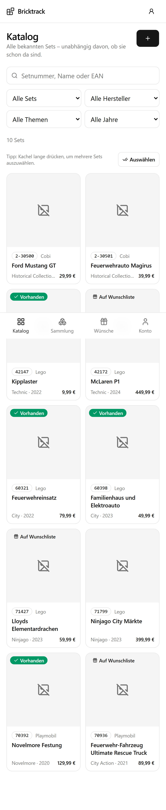

Der Katalog ist die Liste **aller Sets, die du kennst** – unabhängig davon, ob
ihr sie besitzt. Das ist der wichtigste Gedanke der App:

> Ein Set im Katalog heißt „das gibt es". Erst ein Eintrag in der Sammlung
> heißt „das haben wir".

Deshalb kannst du unbesorgt Sets anlegen, die ihr euch nur anschaut – genau
die braucht die Wunschliste später.

**Suchen** kannst du nach Setnummer, Name oder EAN. Die vier Filter darunter:
Besitzstatus, Hersteller, Thema und Jahr. Jeder Filterstand steckt in der
URL – ein Lesezeichen auf „alle fehlenden Lego-Technic-Sets" ist damit möglich.

Die Kacheln zeigen auf einen Blick:

- **grüner Haken „Vorhanden"** – ist in der Sammlung (bei mehreren Exemplaren
  „2× vorhanden")
- **„Auf Wunschliste"** – steht auf mindestens einer Liste
- Setnummer, Hersteller, Thema, Jahr und UVP

Mit **„Set anlegen"** oben rechts kommt ein neues Set dazu. Pflicht sind nur
Hersteller, Setnummer und Name; alles andere kannst du nachtragen. Ein Bild
lädst du entweder hoch (es wird verkleinert und lokal gespeichert) oder du
hinterlegst eine Bild-URL.

---

## 5. Was fehlt noch?

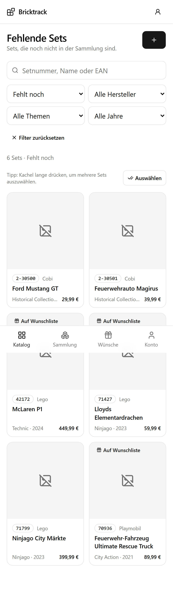

**Katalog → Filter „Fehlt noch"** (oder direkt `/katalog?besitz=fehlt`) zeigt
ausschließlich Sets, die **nicht** in der Sammlung sind. Das ist der zentrale
Weg zur Wunschliste.

### Mehrere Sets auf einmal

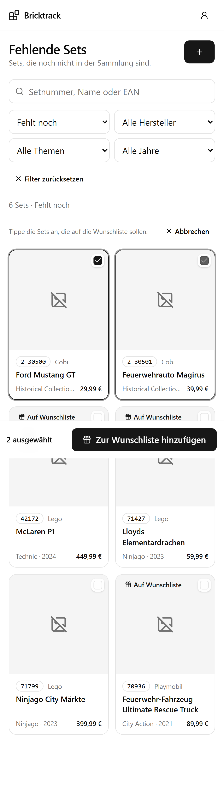

Eine Kachel **lange drücken** startet den Auswahlmodus – am Handy die
natürliche Geste, das Gerät vibriert kurz. Am Rechner tut es der Knopf
**„Auswählen"**. Danach wählt ein Tippen jede weitere Kachel an oder ab.

Unten erscheint die Aktionsleiste mit der Anzahl und dem Knopf **„Zur
Wunschliste hinzufügen"**.

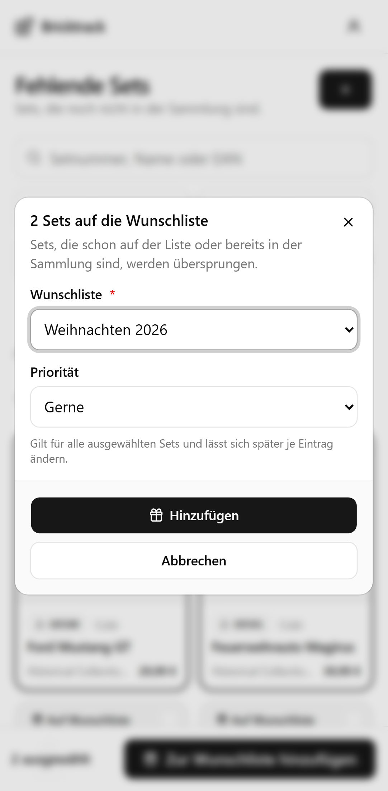

Im Dialog wählst du die Ziel-Wunschliste oder legst gleich eine neue an, dazu
eine Priorität für alle ausgewählten Sets:

| Priorität | Bedeutung |
|---|---|
| Großer Wunsch | Das steht ganz oben |
| Gerne | Der Normalfall |
| Irgendwann | Nice to have |

Die Priorität lässt sich später je Eintrag ändern.

**Doppelte werden übersprungen.** Sets, die schon auf der Liste stehen oder
bereits in der Sammlung sind, werden nicht noch einmal hinzugefügt – die
Meldung danach sagt dir genau, welche das waren und warum. Das ist keine
UI-Höflichkeit, sondern in der Datenbank abgesichert.

---

## 6. Die Set-Detailseite

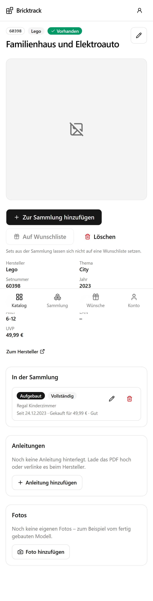

Hier steht alles zu einem Set:

- **Zur Sammlung hinzufügen** – ein Tipp, und das Set gilt als vorhanden.
  Details wie Standort, Zustand oder Kaufpreis trägst du danach nach.
- **Auf Wunschliste** – derselbe Zieldialog wie oben, nur für dieses eine Set.
  Ist das Set bereits in der Sammlung, ist der Knopf ausgegraut: Was da ist,
  gehört nicht auf einen Wunschzettel.
- **Anleitungen** – PDFs hochladen (mehrere je Set, etwa „Buch 1 von 3") und
  direkt im Browser durchblättern, ohne Download und ohne fremde Dienste.
  Alternativ verlinkst du die Anleitung beim Hersteller.
- **Fotos** – eigene Bilder, am Handy direkt aus der Kamera.
- **In der Sammlung** – jedes Exemplar mit Status, Vollständigkeit, Zustand,
  Standort, Kaufdatum, Preis und „geschenkt von".

### Die fünf Status eines Exemplars

| Status | Bedeutung |
|---|---|
| Vorhanden | Da, aber weder auf- noch abgebaut vermerkt |
| Aufgebaut | Steht zusammengebaut im Regal |
| Zerlegt | In Einzelteilen in der Kiste |
| Verliehen | Gerade bei jemand anderem |
| **Verkauft** | Zählt **nicht** mehr als Besitz |

Der letzte Punkt ist wichtig: Ein verkauftes Set taucht wieder unter „Fehlt
noch" auf und darf zurück auf eine Wunschliste.

---

## 7. Die Sammlung

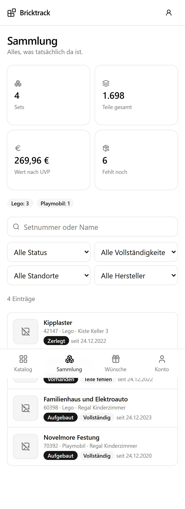

Oben vier Kacheln: Anzahl Sets, Teile insgesamt, Wert nach UVP und wie viele
Sets im Katalog noch fehlen. Darunter die Aufteilung nach Hersteller.

Gefiltert wird nach Status, Vollständigkeit, Standort und Hersteller – nützlich
für die Frage „Was steht eigentlich in Kiste 3?".

Verkaufte Exemplare zählen in keiner Kachel mit.

---

## 8. Wunschlisten

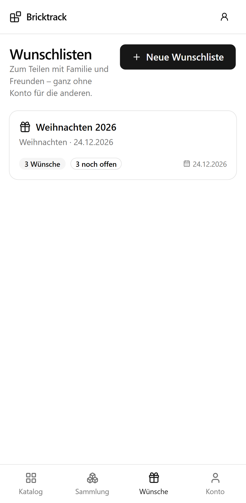

Jede Liste hat einen Titel, einen Anlass und optional einen Termin. Die Karte
zeigt, wie viele Wünsche drauf sind und wie viele davon noch niemand
übernommen hat.

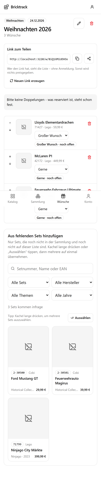

Auf der Liste selbst kannst du:

- die **Reihenfolge** mit den Pfeilen ändern – so stehen die wichtigsten
  Wünsche oben,
- die **Priorität** je Eintrag anpassen,
- Einträge entfernen,
- unten im Bereich **„Aus fehlenden Sets hinzufügen"** direkt weitere Sets
  dazunehmen. Dort steckt dieselbe Auswahlansicht wie im Katalog, schon
  vorgefiltert auf Sets, die weder in der Sammlung noch auf dieser Liste sind.

### Zwei Einstellungen, die den Unterschied machen

- **Über Link teilbar** – ohne diesen Haken ist der öffentliche Link tot.
  Praktisch, wenn du eine Liste erst fertig bauen willst.
- **Überraschungsmodus** – dann siehst *du* nur „Reserviert", nicht von wem.
  Die Schenkenden untereinander sehen die Namen weiterhin, damit niemand
  doppelt kauft.

---

## 9. Teilen

Auf der Wunschliste steht oben der **Link zum Teilen**. Kopieren, oder am
Handy über den Teilen-Knopf direkt in WhatsApp, Signal oder eine Mail geben.

> Der Link ist der einzige Schlüssel. Wer ihn hat, sieht die Liste – mehr
> nicht: keine Sammlung, keine anderen Listen, keine Namen von Konten. Für
> Suchmaschinen ist die Seite gesperrt.
>
> Ist ein Link in falsche Hände geraten, erzeugst du mit **„Neuen Link
> erzeugen"** einen frischen. Der alte funktioniert sofort nicht mehr.

### So sieht es für die Beschenkenden aus

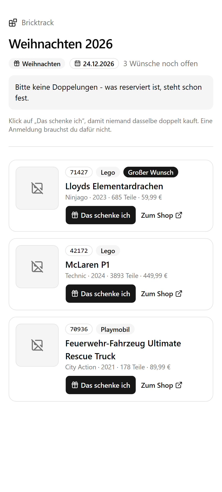

Kein Konto, keine Anmeldung, keine App. Nur die Liste, mit Bild, Setnummer,
Preis, Priorität und – falls hinterlegt – einem Link zum Shop des Herstellers.

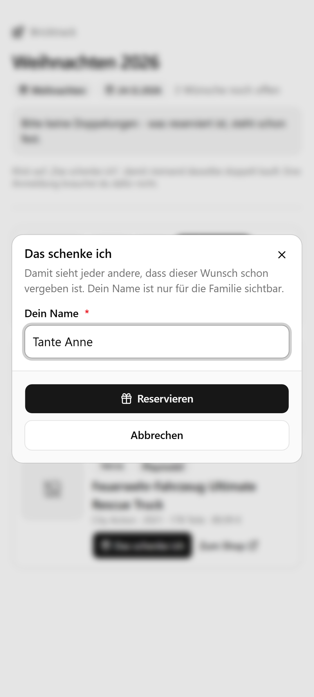

Ein Tipp auf **„Das schenke ich"**, Name eintragen, fertig.

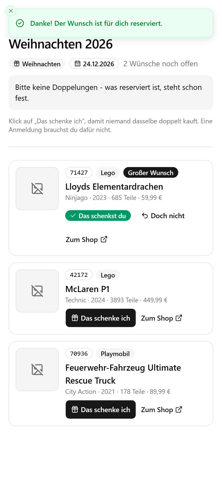

Danach sehen alle anderen, dass dieser Wunsch vergeben ist. Die Person selbst
sieht „Das schenkst du" und kann die Reservierung jederzeit wieder aufheben –
auf demselben Gerät mit einem Tipp, von einem anderen Gerät über den
Storno-Link, den sie beim Reservieren bekommt.

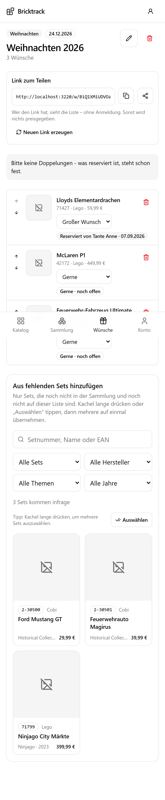

Auf deiner Seite siehst du, wer was übernimmt – oder im Überraschungsmodus
eben nur, *dass* etwas übernommen ist.

**Was passiert, wenn das Geschenk ankommt?** Sobald du das Set zur Sammlung
hinzufügst, markiert Bricktrack den Wunsch automatisch als **erfüllt** und
blendet ihn aus der öffentlichen Ansicht aus. Niemand kauft es dann noch ein
zweites Mal.

---

## 10. Passkeys einrichten

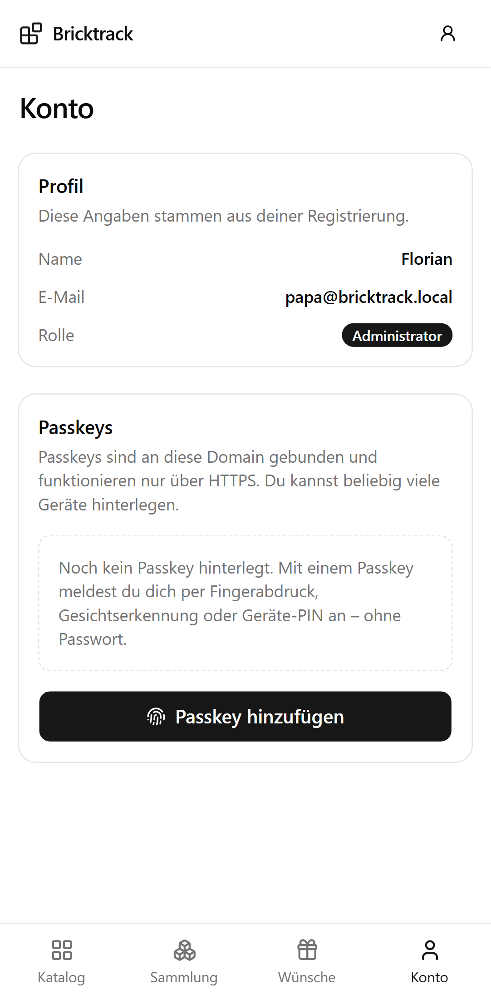

Unter **Konto → Passkeys → Passkey hinzufügen** hinterlegst du Fingerabdruck,
Gesichtserkennung oder die Geräte-PIN als Anmeldung. Danach reicht auf der
Anmeldeseite ein Tipp auf „Mit Passkey anmelden" – auf vielen Geräten schlägt
der Browser den Passkey sogar von selbst vor.

Ein Passkey gilt pro Gerät. Leg ruhig mehrere an – Handy, Tablet, Laptop – und
gib ihnen sprechende Namen.

> **Zwei Dinge, die man wissen muss:**
> 1. Passkeys brauchen HTTPS. Über eine reine `http://`-Adresse (außer
>    `localhost`) bietet der Browser sie gar nicht erst an.
> 2. Passkeys sind an die Domain gebunden. Ziehst du von
>    `bricktrack.example.de` auf eine andere Adresse um, musst du alle
>    Passkeys neu anlegen. Das Passwort funktioniert weiterhin – deshalb ist
>    es sinnvoll, es nicht zu vergessen.

---

## 11. Die zwei Fragen

Dafür ist die ganze App gebaut:

**„Welche Sets hat er?"**
→ Sammlung. Oder im Katalog der Filter „In der Sammlung".

**„Welche Sets hat er noch nicht?"**
→ Katalog, Filter „Fehlt noch". Von dort in zwei Handgriffen auf eine
Wunschliste und per Link zu Oma.

Im Laden vor dem Regal: Katalog öffnen, Setnummer von der Packung eintippen.
Steht ein grüner Haken dran, habt ihr es schon.

---

## Kleinigkeiten, die den Alltag leichter machen

- **Filter stecken in der URL.** Ein Lesezeichen auf
  `/katalog?besitz=fehlt&hersteller=…` ist eine gespeicherte Suche.
- **Preise** kannst du als `12,99` oder `12.99` eintippen – beides wird
  verstanden, gespeichert wird auf den Cent genau.
- **Dasselbe Set zweimal** ist kein Problem: Zwei Exemplare sind zwei Einträge
  in der Sammlung, mit eigenem Standort und Zustand.
- **Anleitungs-PDFs** können groß sein. Kommt beim Hochladen ein Fehler
  „413", muss im Reverse Proxy `client_max_body_size` hoch – siehe
  [QUICKSTART, Schritt 5](../QUICKSTART.md#5-reverse-proxy-einrichten-nginx-proxy-manager).
- **Alles Wichtige liegt in `./data`.** Dieses eine Verzeichnis sichern
  genügt – Datenbank, Bilder, Fotos und Anleitungen sind darin.
