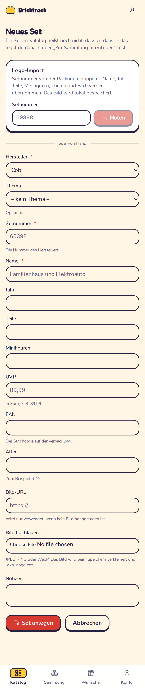
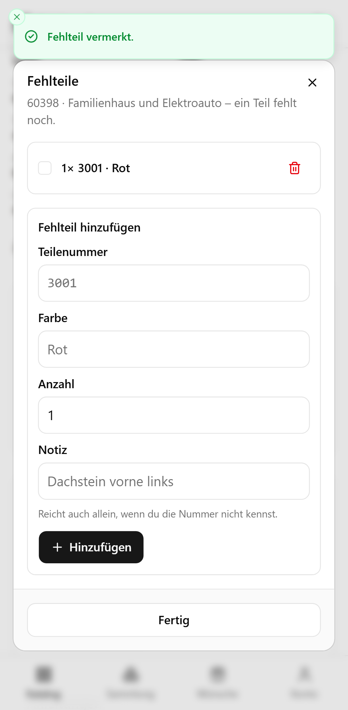
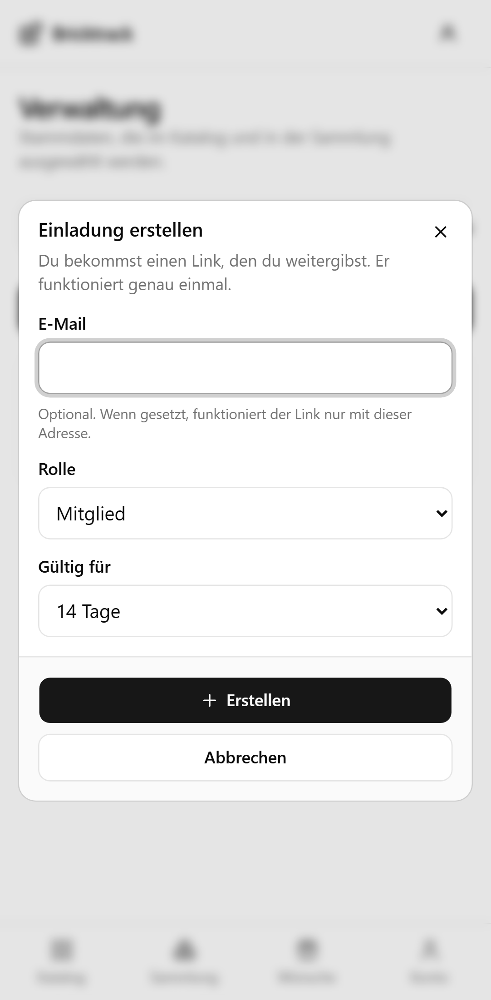
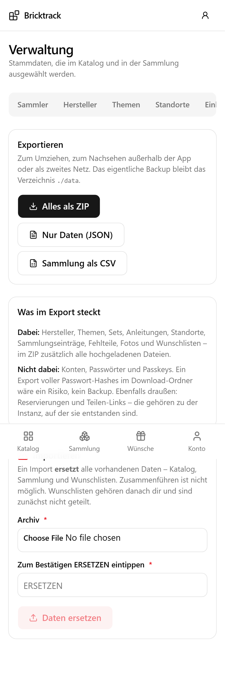
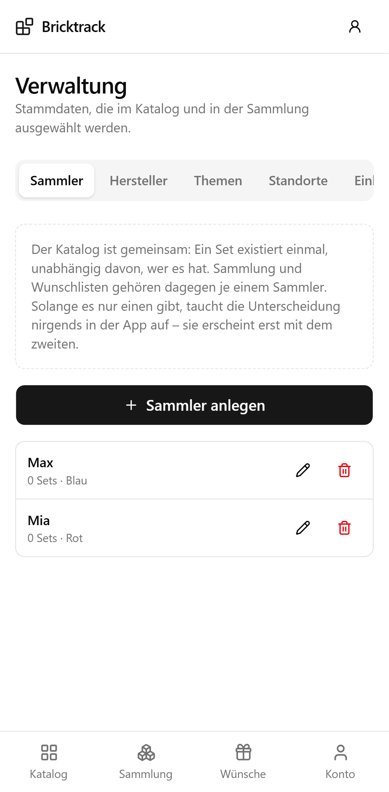
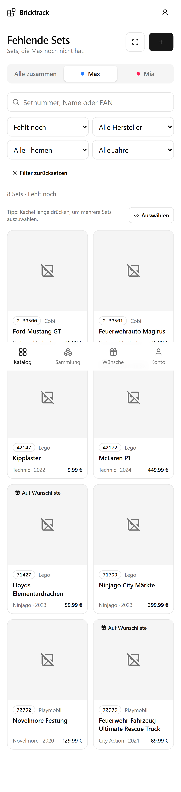
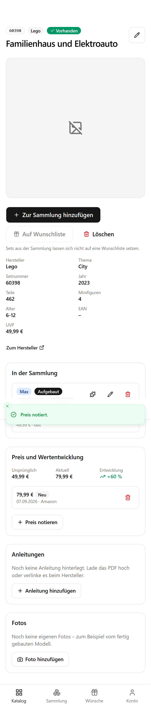
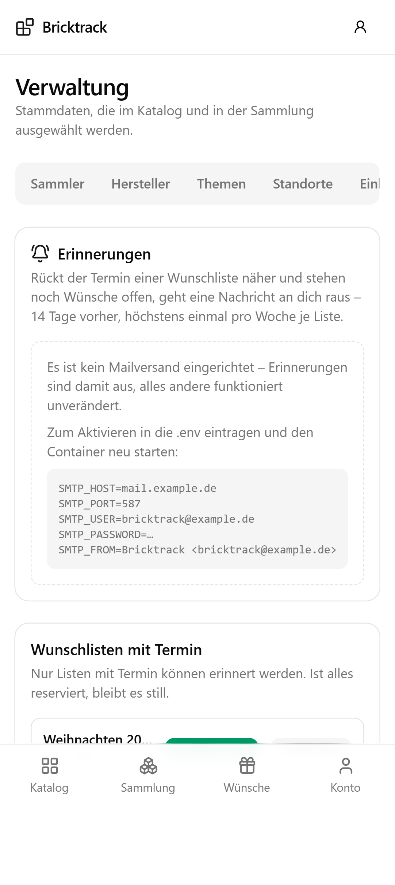

# Bricktrack – Anleitung

So benutzt du Bricktrack im Alltag. Die Bilder sind auf einem Handy
aufgenommen, weil die App genau dafür gebaut ist: für den Laden und das
Kinderzimmer, nicht für den Schreibtisch.

> Installation und Reverse Proxy stehen im [Schnellstart](../QUICKSTART.md).
> Die Bilder hier lassen sich mit `pnpm screenshots` jederzeit neu erzeugen –
> sie stammen aus den Beispieldaten des Seed-Skripts.

---

## Inhalt

1. [Das erste Konto](#1-das-erste-konto)
2. [Der Überblick](#2-der-überblick)
3. [Stammdaten anlegen](#3-stammdaten-anlegen)
4. [Sets in den Katalog](#4-sets-in-den-katalog)
5. [Was fehlt noch? Mehrere Sets auf einmal auswählen](#5-was-fehlt-noch)
6. [Die Set-Detailseite](#6-die-set-detailseite)
7. [Die Sammlung](#7-die-sammlung)
8. [Wunschlisten](#8-wunschlisten)
9. [Teilen – so sehen es Oma und Tante Anne](#9-teilen)
10. [Passkeys einrichten](#10-passkeys-einrichten)
11. [Sets im Schnellverfahren: Import und Scanner](#11-import-und-scanner)
12. [Fehlteile](#12-fehlteile)
13. [Noch ein Konto für die Familie](#13-einladungen)
14. [Daten sichern, umziehen, auswerten](#14-daten)
15. [Auf den Startbildschirm legen](#15-startbildschirm)
16. [Zwei Kinder, ein Katalog](#16-mehrere-sammler)
17. [Was ein Set heute wert ist](#17-preise)
18. [Erinnerung vor dem Termin](#18-erinnerungen)
19. [Schutz vor doppelten Einträgen](#19-dubletten)
20. [Antworten auf die zwei wichtigen Fragen](#20-die-zwei-fragen)

---

## 1. Das erste Konto


Beim allerersten Aufruf landest du direkt auf der Registrierung. **Wer sich
zuerst registriert, wird Administrator** – danach ist die Registrierung
geschlossen. Melde dich also gleich selbst an, bevor es jemand anderes tut.

Das Passwort braucht mindestens zehn Zeichen. Einen Passkey hinterlegst du
gleich danach unter „Konto" (siehe [Abschnitt 10](#10-passkeys-einrichten)).

---

## 2. Der Überblick


Die Startseite ist die Abzweigung zu den vier Bereichen:

| | |
|---|---|
| **Katalog** | Alle bekannten Sets – egal ob vorhanden oder nicht |
| **Fehlende Sets** | Der direkte Weg zu allem, was noch fehlt |
| **Sammlung** | Was tatsächlich da ist |
| **Wunschlisten** | Zum Teilen mit Familie und Freunden |

Unten am Bildschirmrand liegt die Navigation – auf dem Handy mit dem Daumen
erreichbar.

---

## 3. Stammdaten anlegen


Bevor du Sets anlegst, brauchst du mindestens einen **Hersteller**. Zu finden
über das Konto-Menü oben rechts → **Verwaltung**.

Drei Arten von Stammdaten:

- **Hersteller** – Lego, Playmobil, Cobi, BlueBrixx … beliebig erweiterbar.
  Die hinterlegte Website erscheint später als „Zum Shop"-Link auf der
  geteilten Wunschliste.
- **Themen** – Serien wie „City", „Technic", „Novelmore". Themen gehören zu
  einem Hersteller und können Unterthemen haben („City → Feuerwehr").
- **Standorte** – „Regal Kinderzimmer", „Kiste Keller 3". Auch schachtelbar,
  damit „Keller → Kiste 3" möglich ist.

> Ein Hersteller oder Thema lässt sich nicht löschen, solange noch Sets daran
> hängen. Standorte schon – die betroffenen Sammlungseinträge verlieren dann
> nur ihren Standort.

---

## 4. Sets in den Katalog


Der Katalog ist die Liste **aller Sets, die du kennst** – unabhängig davon, ob
ihr sie besitzt. Das ist der wichtigste Gedanke der App:

> Ein Set im Katalog heißt „das gibt es". Erst ein Eintrag in der Sammlung
> heißt „das haben wir".

Deshalb kannst du unbesorgt Sets anlegen, die ihr euch nur anschaut – genau
die braucht die Wunschliste später.

**Suchen** kannst du nach Setnummer, Name oder EAN. Die vier Filter darunter:
Besitzstatus, Hersteller, Thema und Jahr. Jeder Filterstand steckt in der
URL – ein Lesezeichen auf „alle fehlenden Lego-Technic-Sets" ist damit möglich.

Die Kacheln zeigen auf einen Blick:

- **grüner Haken „Vorhanden"** – ist in der Sammlung (bei mehreren Exemplaren
  „2× vorhanden")
- **„Auf Wunschliste"** – steht auf mindestens einer Liste
- Setnummer, Hersteller, Thema, Jahr und UVP

Mit **„Set anlegen"** oben rechts kommt ein neues Set dazu. Pflicht sind nur
Hersteller, Setnummer und Name; alles andere kannst du nachtragen. Ein Bild
lädst du entweder hoch (es wird verkleinert und lokal gespeichert) oder du
hinterlegst eine Bild-URL.

---

## 5. Was fehlt noch?


**Katalog → Filter „Fehlt noch"** (oder direkt `/katalog?besitz=fehlt`) zeigt
ausschließlich Sets, die **nicht** in der Sammlung sind. Das ist der zentrale
Weg zur Wunschliste.

### Mehrere Sets auf einmal


Eine Kachel **lange drücken** startet den Auswahlmodus – am Handy die
natürliche Geste, das Gerät vibriert kurz. Am Rechner tut es der Knopf
**„Auswählen"**. Danach wählt ein Tippen jede weitere Kachel an oder ab.

Unten erscheint die Aktionsleiste mit der Anzahl und dem Knopf **„Zur
Wunschliste hinzufügen"**.


Im Dialog wählst du die Ziel-Wunschliste oder legst gleich eine neue an, dazu
eine Priorität für alle ausgewählten Sets:

| Priorität | Bedeutung |
|---|---|
| Großer Wunsch | Das steht ganz oben |
| Gerne | Der Normalfall |
| Irgendwann | Nice to have |

Die Priorität lässt sich später je Eintrag ändern.

**Doppelte werden übersprungen.** Sets, die schon auf der Liste stehen oder
bereits in der Sammlung sind, werden nicht noch einmal hinzugefügt – die
Meldung danach sagt dir genau, welche das waren und warum. Das ist keine
UI-Höflichkeit, sondern in der Datenbank abgesichert.

---

## 6. Die Set-Detailseite


Hier steht alles zu einem Set:

- **Zur Sammlung hinzufügen** – ein Tipp, und das Set gilt als vorhanden.
  Details wie Standort, Zustand oder Kaufpreis trägst du danach nach.
- **Auf Wunschliste** – derselbe Zieldialog wie oben, nur für dieses eine Set.
  Ist das Set bereits in der Sammlung, ist der Knopf ausgegraut: Was da ist,
  gehört nicht auf einen Wunschzettel.
- **Anleitungen** – PDFs hochladen (mehrere je Set, etwa „Buch 1 von 3") und
  direkt im Browser durchblättern, ohne Download und ohne fremde Dienste.
  Alternativ verlinkst du die Anleitung beim Hersteller.
- **Fotos** – eigene Bilder, am Handy direkt aus der Kamera.
- **In der Sammlung** – jedes Exemplar mit Status, Vollständigkeit, Zustand,
  Standort, Kaufdatum, Preis und „geschenkt von".

### Die fünf Status eines Exemplars

| Status | Bedeutung |
|---|---|
| Vorhanden | Da, aber weder auf- noch abgebaut vermerkt |
| Aufgebaut | Steht zusammengebaut im Regal |
| Zerlegt | In Einzelteilen in der Kiste |
| Verliehen | Gerade bei jemand anderem |
| **Verkauft** | Zählt **nicht** mehr als Besitz |

Der letzte Punkt ist wichtig: Ein verkauftes Set taucht wieder unter „Fehlt
noch" auf und darf zurück auf eine Wunschliste.

---

## 7. Die Sammlung


Oben vier Kacheln: Anzahl Sets, Teile insgesamt, Wert nach UVP und wie viele
Sets im Katalog noch fehlen. Darunter die Aufteilung nach Hersteller.

Gefiltert wird nach Status, Vollständigkeit, Standort und Hersteller – nützlich
für die Frage „Was steht eigentlich in Kiste 3?".

Verkaufte Exemplare zählen in keiner Kachel mit.

---

## 8. Wunschlisten


Jede Liste hat einen Titel, einen Anlass und optional einen Termin. Die Karte
zeigt, wie viele Wünsche drauf sind und wie viele davon noch niemand
übernommen hat.


Auf der Liste selbst kannst du:

- die **Reihenfolge** mit den Pfeilen ändern – so stehen die wichtigsten
  Wünsche oben,
- die **Priorität** je Eintrag anpassen,
- Einträge entfernen,
- unten im Bereich **„Aus fehlenden Sets hinzufügen"** direkt weitere Sets
  dazunehmen. Dort steckt dieselbe Auswahlansicht wie im Katalog, schon
  vorgefiltert auf Sets, die weder in der Sammlung noch auf dieser Liste sind.

### Zwei Einstellungen, die den Unterschied machen

- **Über Link teilbar** – ohne diesen Haken ist der öffentliche Link tot.
  Praktisch, wenn du eine Liste erst fertig bauen willst.
- **Überraschungsmodus** – dann siehst *du* nur „Reserviert", nicht von wem.
  Die Schenkenden untereinander sehen die Namen weiterhin, damit niemand
  doppelt kauft.

---

## 9. Teilen

Auf der Wunschliste steht oben der **Link zum Teilen**. Kopieren, oder am
Handy über den Teilen-Knopf direkt in WhatsApp, Signal oder eine Mail geben.

> Der Link ist der einzige Schlüssel. Wer ihn hat, sieht die Liste – mehr
> nicht: keine Sammlung, keine anderen Listen, keine Namen von Konten. Für
> Suchmaschinen ist die Seite gesperrt.
>
> Ist ein Link in falsche Hände geraten, erzeugst du mit **„Neuen Link
> erzeugen"** einen frischen. Der alte funktioniert sofort nicht mehr.

### So sieht es für die Beschenkenden aus


Kein Konto, keine Anmeldung, keine App. Nur die Liste, mit Bild, Setnummer,
Preis, Priorität und – falls hinterlegt – einem Link zum Shop des Herstellers.


Ein Tipp auf **„Das schenke ich"**, Name eintragen, fertig.


Danach sehen alle anderen, dass dieser Wunsch vergeben ist. Die Person selbst
sieht „Das schenkst du" und kann die Reservierung jederzeit wieder aufheben –
auf demselben Gerät mit einem Tipp, von einem anderen Gerät über den
Storno-Link, den sie beim Reservieren bekommt.


Auf deiner Seite siehst du, wer was übernimmt – oder im Überraschungsmodus
eben nur, *dass* etwas übernommen ist.

**Was passiert, wenn das Geschenk ankommt?** Sobald du das Set zur Sammlung
hinzufügst, markiert Bricktrack den Wunsch automatisch als **erfüllt** und
blendet ihn aus der öffentlichen Ansicht aus. Niemand kauft es dann noch ein
zweites Mal.

---

## 10. Passkeys einrichten


Unter **Konto → Passkeys → Passkey hinzufügen** hinterlegst du Fingerabdruck,
Gesichtserkennung oder die Geräte-PIN als Anmeldung. Danach reicht auf der
Anmeldeseite ein Tipp auf „Mit Passkey anmelden" – auf vielen Geräten schlägt
der Browser den Passkey sogar von selbst vor.

Ein Passkey gilt pro Gerät. Leg ruhig mehrere an – Handy, Tablet, Laptop – und
gib ihnen sprechende Namen.

> **Zwei Dinge, die man wissen muss:**
> 1. Passkeys brauchen HTTPS. Über eine reine `http://`-Adresse (außer
>    `localhost`) bietet der Browser sie gar nicht erst an.
> 2. Passkeys sind an die Domain gebunden. Ziehst du von
>    `bricktrack.example.de` auf eine andere Adresse um, musst du alle
>    Passkeys neu anlegen. Das Passwort funktioniert weiterhin – deshalb ist
>    es sinnvoll, es nicht zu vergessen.

---

## 11. Import und Scanner

Sets von Hand einzutippen ist der langsame Weg. Für Lego gibt es zwei
schnellere.

### Lego-Import über die Setnummer



Auf **Katalog → Set anlegen** steht oben das Feld für den Import. Setnummer
von der Packung eintippen, „Holen" – und Name, Jahr, Teile, Minifiguren und
Thema stehen drin. Das Bild wird **lokal gespeichert**, funktioniert also auch
weiter, wenn die Quelle es irgendwann austauscht. Fehlen Hersteller oder
Thema noch, legt der Import sie an.

Dafür braucht es einen kostenlosen API-Key von
[rebrickable.com/api](https://rebrickable.com/api/), eingetragen als
`REBRICKABLE_API_KEY` in der `.env`. Ohne Key steht an derselben Stelle ein
Hinweis, und alles andere funktioniert unverändert weiter.

> Anleitungsdateien liefert Rebrickable nicht. Der Import legt stattdessen
> einen Link auf die LEGO-Serviceseite zur Setnummer an – von dort kommst du
> zum PDF, das du dann hochladen kannst.

### Barcode scannen

Im Katalog sitzt neben „Set anlegen" ein Scanner-Symbol. Strichcode der
Packung ins Bild halten:

- **Set schon im Katalog** → es öffnet sich direkt. Genau das, was man im
  Laden vor dem Regal wissen will.
- **Noch unbekannt** → das Formular „Neues Set" öffnet sich mit
  ausgefüllter EAN.

Gelesen wird ausschließlich im Browser, es geht nichts an einen fremden
Dienst. Jeder Code wird gegen seine Prüfziffer geprüft – verlesene Ziffern
landen so gar nicht erst im Katalog. Die Kamera braucht wie Passkeys HTTPS.

---

## 12. Fehlteile



Beim Aufbauen fehlt ein Stein. Auf der Set-Detailseite hat jeder
Sammlungseintrag ein Puzzle-Symbol: dort trägst du ein, was fehlt – mit
Teilenummer und Farbe, wenn du sie kennst, sonst reicht eine Notiz wie
„Dachstein vorne links".

Ist das Teil nachgekauft, hakst du es ab. Die **Vollständigkeit pflegt sich
dabei selbst**: Der erste offene Eintrag setzt den Sammlungseintrag auf
„Teile fehlen", der letzte erledigte zurück auf „vollständig". Der Filter in
der Sammlung stimmt damit, ohne dass du daran denken musst.

---

## 13. Einladungen



Die Registrierung ist nach dem ersten Konto geschlossen – sonst könnte sich
jeder, der die Adresse kennt, ein Konto anlegen. Für den zweiten Elternteil
gibt es deshalb **Verwaltung → Einladungen**:

1. „Einladung erstellen", optional an eine E-Mail-Adresse gebunden, mit Rolle
   und Gültigkeit.
2. Den Link kopieren und weitergeben. Er wird **nur einmal angezeigt** – in
   der Datenbank liegt nur sein Hash.
3. Die eingeladene Person legt darüber ihr Konto an. Danach ist der Link
   verbraucht.

„Mitglied" darf die Sammlung pflegen und Wunschlisten anlegen; „Administrator"
zusätzlich einladen und Daten exportieren.

---

## 14. Daten



Unter **Verwaltung → Daten** gibt es drei Downloads:

| | Wofür |
|---|---|
| **Alles als ZIP** | Umziehen auf einen anderen Server, zweites Netz |
| **Nur Daten (JSON)** | Zum Reinschauen oder Weiterverarbeiten |
| **Sammlung als CSV** | Für Excel oder LibreOffice, Semikolon-getrennt |

**Nicht im Export:** Konten, Passwörter und Passkeys. Ein Export voller
Passwort-Hashes im Download-Ordner wäre ein Risiko, kein Backup. Ebenso außen
vor: Reservierungen und Teilen-Links – die gehören zu der Instanz, auf der sie
entstanden sind.

> **Das richtige Backup bleibt `./data`.** Ein Verzeichnis, Datenbank und
> Dateien darin. Siehe [README](../README.md#backup-und-restore).

Der **Import** liest ein solches ZIP wieder ein – und **ersetzt dabei alle
vorhandenen Daten**. Zusammenführen zweier Sammlungen ist bewusst nicht
möglich: Es bräuchte Konfliktregeln für jede Tabelle, und das Ergebnis wäre
nicht vorhersagbar. Deshalb muss man zur Bestätigung `ERSETZEN` eintippen.
Wunschlisten gehören danach dir und sind zunächst nicht geteilt.

---

## 15. Startbildschirm

Bricktrack lässt sich wie eine App installieren:

- **iPhone/iPad (Safari):** Teilen-Symbol → „Zum Home-Bildschirm".
- **Android (Chrome):** Menü → „App installieren" bzw. „Zum Startbildschirm
  hinzufügen".

Danach startet Bricktrack ohne Browserleiste, und langes Drücken auf das Symbol
springt direkt zu „Fehlende Sets" oder zur Sammlung.

**Ohne Verbindung** bleibt lesbar, was du schon einmal geöffnet hast – der
Katalog also, wenn du ihn vorher im WLAN durchgeblättert hast. Ändern lässt
sich offline nichts: Eine Reservierung, die nur auf deinem Gerät liegt, wäre
für alle anderen unsichtbar und damit eine Lüge. Beim Abmelden räumt die App
den Zwischenspeicher, damit auf einem geteilten Gerät nichts lesbar bleibt.

---

## 16. Mehrere Sammler



Kommt ein zweites Kind dazu, wird aus „hat er das schon?" die Frage „hat
**er** das schon?". Genau dafür gibt es Sammler.

Der **Katalog bleibt gemeinsam**: Ein Set existiert einmal, unabhängig davon,
wer es besitzt. **Sammlung und Wunschlisten** gehören dagegen je einem
Sammler. Ein Set, das nur die Schwester hat, fällt für den Bruder wieder unter
„fehlt noch" – und darf auf seine Wunschliste.

> **Solange es nur einen Sammler gibt, siehst du davon nichts.** Kein
> Umschalter, keine Abfrage, keine Farben. Die App bleibt genauso einfach wie
> vorher. Erst der zweite Sammler schaltet all das frei – und dann willst du
> es auch.

Anlegen unter **Verwaltung → Sammler**. Jeder bekommt einen Namen und eine
Farbe zur Unterscheidung.



Danach steht in Katalog und Sammlung oben ein Umschalter. „Alle zusammen"
zeigt den Haushalt als Ganzes, ein Name zeigt genau dessen Sicht – inklusive
der Frage, was **diesem** Kind noch fehlt.

Beim Hinzufügen zur Sammlung fragt die App jetzt, wer das Set bekommt. Und
beim Anlegen einer Wunschliste, für wen sie ist: Das bestimmt, wessen Sammlung
als „hat er schon" zählt und wann ein Wunsch automatisch als erfüllt gilt.

> Die Umstellung einer bestehenden Instanz macht nichts kaputt: Beim Update
> entsteht ein Sammler namens „Sammlung", dem alles Vorhandene gehört.
> Umbenennen unter **Verwaltung → Sammler**, fertig.

---

## 17. Preise



Auf jeder Set-Seite gibt es **„Preis notieren"**: Betrag, Zustand (neu oder
gebraucht), wann und wo gesehen. Daraus wird eine Reihe – und damit eine
Antwort auf die eigentlich interessante Frage: Was hat das Set seit dem Kauf
gemacht?

- **Ursprünglich** ist die UVP des Sets, sonst der älteste notierte Preis.
- **Aktuell** ist der neueste notierte Preis.
- **Entwicklung** ist die Differenz in Prozent.

In der Sammlung wird die Kachel „Wert nach UVP" automatisch zu **„Aktueller
Wert"**, sobald irgendwo ein Preis notiert ist.

> Es wird **kein** Preisdienst abgefragt. Was hier steht, hast du selbst
> eingetragen – das ist ehrlicher als eine Zahl, deren Herkunft niemand kennt,
> und es geht nichts nach draußen.

---

## 18. Erinnerungen



Wenn ein Wunschlisten-Termin näher rückt und **noch Wünsche offen sind**,
schickt Bricktrack dir eine E-Mail – standardmäßig 14 Tage vorher, höchstens
einmal pro Woche je Liste. Ist alles reserviert, bleibt es still: eine
Erinnerung ohne Handlungsbedarf ist nur Lärm.

Dafür braucht es einen SMTP-Zugang in der `.env`:

```bash
SMTP_HOST=mail.example.de
SMTP_PORT=587
SMTP_USER=bricktrack@example.de
SMTP_PASSWORD=…
SMTP_FROM=Bricktrack <bricktrack@example.de>

# Optional, Standard ist 14:
REMINDER_DAYS_BEFORE=14
```

Unter **Verwaltung → Erinnerungen** kannst du die Verbindung prüfen, dir eine
Testnachricht schicken und die Prüfung sofort auslösen, statt auf die nächste
Stunde zu warten. Dort steht auch, welche Listen einen Termin haben und wie
viel dort noch offen ist.

Ohne SMTP-Zugang ist die Funktion vollständig aus – alles andere funktioniert
unverändert.

---

## 19. Dubletten

Beim Anlegen eines neuen Sets schaut Bricktrack nach, ob es das schon gibt:

- **gleiche Setnummer beim gleichen Hersteller** – dann ist es dasselbe Set,
- **sehr ähnlicher Name** – meist ein Tippfehler oder eine andere Schreibweise,
- **gleiche Nummer bei einem anderen Hersteller** – meist der falsche
  Hersteller im Formular.

Passt etwas, erscheint ein Hinweis mit Link zu den Verdächtigen. Von dort
kommst du direkt zum vorhandenen Eintrag – oder legst mit „Trotzdem anlegen"
weiter an, wenn es wirklich ein anderes Set ist.

Die Erkennung ist bewusst zurückhaltend eingestellt: Tippfehler schlagen an,
zwei echte Sets desselben Themas nicht.

---

## 20. Die zwei Fragen

Dafür ist die ganze App gebaut:

**„Welche Sets hat er?"**
→ Sammlung. Oder im Katalog der Filter „In der Sammlung".

**„Welche Sets hat er noch nicht?"**
→ Katalog, Filter „Fehlt noch". Von dort in zwei Handgriffen auf eine
Wunschliste und per Link zu Oma. Bei mehreren Kindern beantwortet der
Umschalter oben die Frage für jedes einzeln.

Im Laden vor dem Regal: Scanner öffnen, Strichcode einlesen. Steht ein grüner
Haken dran, habt ihr es schon.

---

## Kleinigkeiten, die den Alltag leichter machen

- **Filter stecken in der URL.** Ein Lesezeichen auf
  `/katalog?besitz=fehlt&hersteller=…` ist eine gespeicherte Suche.
- **Preise** kannst du als `12,99` oder `12.99` eintippen – beides wird
  verstanden, gespeichert wird auf den Cent genau.
- **Dasselbe Set zweimal** ist kein Problem: Zwei Exemplare sind zwei Einträge
  in der Sammlung, mit eigenem Standort und Zustand.
- **Anleitungs-PDFs** können groß sein. Kommt beim Hochladen ein Fehler
  „413", muss im Reverse Proxy `client_max_body_size` hoch – siehe
  [QUICKSTART, Schritt 5](../QUICKSTART.md#5-reverse-proxy-einrichten-nginx-proxy-manager).
- **Alles Wichtige liegt in `./data`.** Dieses eine Verzeichnis sichern
  genügt – Datenbank, Bilder, Fotos und Anleitungen sind darin.
